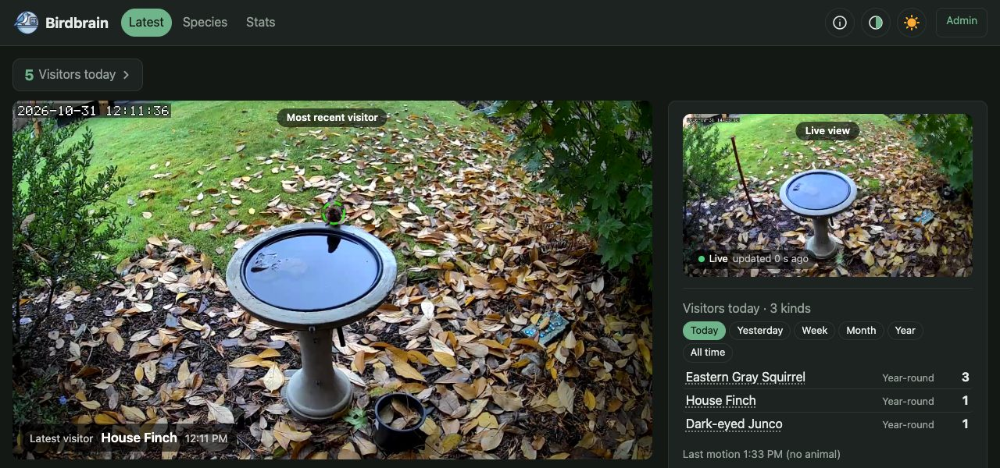
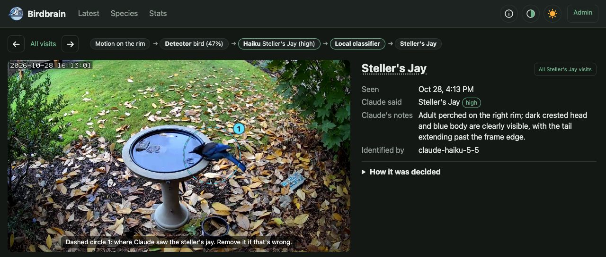
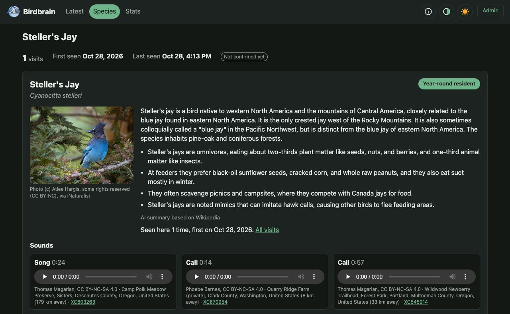
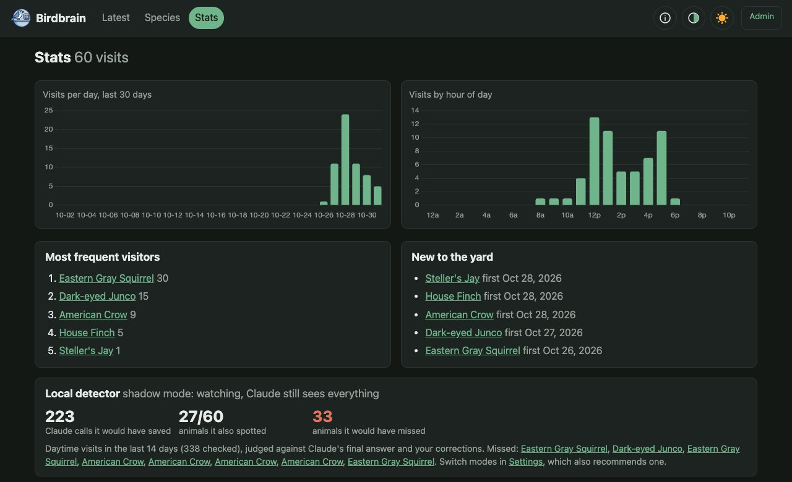
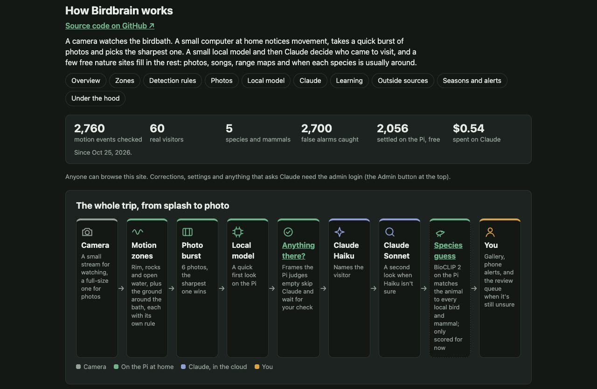
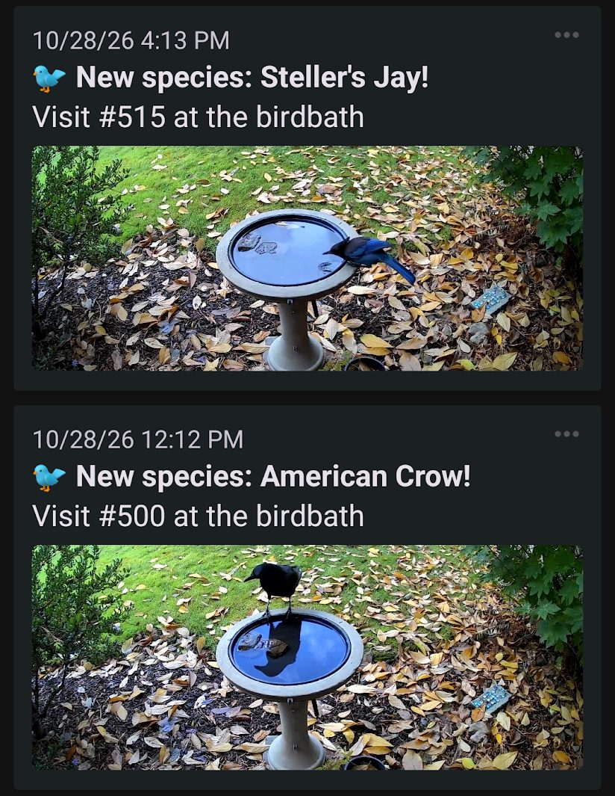

# Birdbrain

A backyard birdbath camera that spots visitors and identifies them with Claude, then shows them on a website on your home network: latest visitors, species, stats, and a live view.



<table>
<tr>
<td width="50%"><br><b>Every visit</b> shows the photo (with its crop box and the motion zone that took it drawn on), where the animal was spotted, and each step that decided it: motion zone, local detector, Claude Haiku, the local BioCLIP 2 guess.</td>
<td width="50%"><br><b>Species cards</b> with a reference photo, behavior notes, songs and calls recorded nearby, and when the species is usually around in your county.</td>
</tr>
<tr>
<td width="50%"><br><b>Stats</b>: visits by day and hour, top visitors, new arrivals, and scorecards that show how well the local models would do without Claude.</td>
<td width="50%"><br><b>How it works</b>, built into the site: live totals (2,700 false alarms caught, $0.54 spent on Claude) and the trip from splash to photo.</td>
</tr>
<tr>
<td width="50%"></td>
<td width="50%"><b>Phone alerts</b> through the free <a href="https://ntfy.sh">ntfy</a> app, with the photo attached: a species seen for the first time, any raccoon or possum, and birds showing up outside their usual season. Quiet hours and each kind of alert are set on the Settings page.</td>
</tr>
</table>

- A cheap Wi-Fi camera watches the birdbath.
- Motion on the rim (not ripples in the water) triggers a burst of photos.
- Claude Haiku identifies the visitor from the sharpest photo. If it isn't sure, Claude Sonnet takes a second look at three photos. If it's still unsure, the visit waits for you on the Review page.
- When you correct a mistake, your correction is shown to Claude on future photos, so it learns your birdbath's quirks.
- Did it miss an animal? Circle it on the visit page and ask the Pi's own model what's in the circle (free); only if the Pi isn't sure, ask Claude Haiku, then Sonnet, about just that part of the photo.
- Phone alerts come through [ntfy.sh](https://ntfy.sh), a notification service that takes minutes to set up: install the free ntfy app, subscribe to a topic name you make up, and put the same name on the Settings page. No account or server needed, and the free tier allows 250 notifications a day, far more than a birdbath sends.

> **A note on Claude tokens:** a big part of this project is spending as few Claude API tokens as possible. Claude is very good at naming birds, but most motion at a birdbath is rain, leaves and ripples, and on busy days nearly every call was an empty frame. So the work is steadily moving onto a stronger local model running on the Pi itself: [BioCLIP 2](#local-species-classifier-shadow-mode) already decides whether anything is there at all (the [local animal check](#local-animal-check), which keeps empty frames off Claude) and makes its own species guess on every visit, scored against Claude's answers (25 of the first 28 birds right on its first guess). The goal is for the Pi to name the everyday visitors by itself and to save Claude for the hard cases: new species, odd angles, night visitors and anything the local model isn't sure about.

## What you need

| Part | Notes |
|---|---|
| Camera with RTSP | Tested with a Wyze Cam v3 (~$30) flashed with [Thingino](https://thingino.com) open firmware (no soldering: SD-card installer from [wltechblog/thingino-installers](https://github.com/wltechblog/thingino-installers)). Any camera with an RTSP main stream and a smaller substream should work. |
| Always-on computer | A Raspberry Pi 4 (2 GB+) on your network runs the watcher and the website. A Mac or Linux PC works for trying it out. |
| Anthropic API key | Pay-as-you-go. A typical backyard costs a few dollars a month (see below). |
| Software | Python 3.11+, [uv](https://docs.astral.sh/uv/), ffmpeg. |

<details>
<summary>Set it up with Claude Code</summary>

Install [Claude Code](https://claude.com/claude-code), clone this repo, run `claude` inside it, and paste the prompt below. Claude walks you through setup one checkpoint at a time and checks each before moving on.

```text
Help me set up Birdbrain, a backyard birdbath camera, from this repo. Read README.md, .env.example
and scripts/deploy.sh first, and use only the settings, scripts and commands they describe.

Work through these checkpoints in order. Ask me ONE question at a time, wait for my answer, and
verify each checkpoint before moving on. If a check fails, help me fix it before continuing.

1. Camera: which model is it, and is Thingino (or another firmware with RTSP) already flashed?
   If not, point me at the flashing notes in the README's "What you need" table and wait.
2. Camera access: ask for its hostname or IP, RTSP port and user. Ask me to type the RTSP
   password into .env myself, or write it there without ever printing it back. Create .env from
   .env.example, set CAM_HOST, RTSP_PORT, RTSP_USER, RTSP_PASS and the stream paths, then verify
   with scripts/snap.sh main and scripts/snap.sh sub and show me the frames.
3. Where it runs: a Raspberry Pi (which model, how much RAM, free disk) or a Mac/PC to try it
   out first. Check Python 3.11+, uv and ffmpeg are installed, then run uv sync. For a Pi, ask
   for the SSH user and address, confirm key-based ssh works, and set DEPLOY_HOST and DEPLOY_USER.
4. Claude API: walk me through the README's "Set up the Anthropic API key safely" section
   (prepaid credits, auto-reload off, a key just for Birdbrain). I paste it into .env as
   ANTHROPIC_API_KEY; never echo it.
5. Try it locally: start the website and the watcher (README "Try it locally") and confirm the
   site loads.
6. Aim and calibrate: follow the README's "Aim and calibrate". Help me place the camera, run
   birdbrain.calibrate on a fresh frame, look at the preview, and copy the values that fit
   (MOTION_RING, MOTION_SPOTS, CROP_ROI, optionally GROUND_ZONE) into .env.
7. Deploy (Pi only): run scripts/deploy.sh, then check that birdbrain-web and birdbrain-watch are
   active and read the watcher's journalctl output for errors. Make .env edits on this machine
   and redeploy, never by editing the copy on the Pi.
8. Optional extras, offering each and skipping any I decline: ntfy phone alerts, XC_API_KEY
   (xeno-canto sounds), INAT_PLACE_ID for my county (the .env.example comment shows how to look
   it up), SITE_LAT and SITE_LON, SITE_URL, and ADMIN_PASSWORD for read-only mode.
9. Finally, point me to Claude's Notes on the site to describe what the camera sees, and tell me
   what to check after the first rain or first visitor.

Never commit .env or anything with my address, passwords or keys.
```

</details>

## Set up the Anthropic API key safely

1. Create an account at [console.anthropic.com](https://console.anthropic.com) and add **prepaid credits**. About **$20** is plenty to start.
2. **Turn auto-reload off.** Then a leaked key can never spend more than what's left on the balance.
3. Create an API key for Birdbrain only. A key that doesn't expire is fine here, because the small prepaid balance is what limits your exposure.
4. Put the key in `.env` (below), never in code, chat, or a commit.

Cost per photo is tiny: Haiku on a cropped photo is about $0.00015; a Sonnet second look with three photos is under a cent. `MAX_CALLS_PER_DAY` (default 500) is a hard daily cap.

## Install

```bash
git clone <this repo> birdbrain && cd birdbrain
uv sync
cp .env.example .env      # then edit .env: camera address and password, API key, Pi address
```

Check the camera stream:

```bash
scripts/snap.sh main      # saves a full-resolution frame to snapshots/
```

Try it locally:

```bash
uv run uvicorn birdbrain.web.app:app --port 8000      # the website: http://localhost:8000
uv run python -m birdbrain.watch                       # the watcher (Ctrl-C to stop)
```

## Aim and calibrate

1. Mount the camera 2 to 3 feet from the bath, above it and angled down 30 to 45 degrees. That shows the whole rim, makes the water reflect sky instead of your house, and keeps moving background out of view.
2. Draw the areas to watch and to send to Claude, and check them on a real frame:

   ```bash
   uv run python -m birdbrain.calibrate preview.jpg --ring cx,cy,orx,ory,irx,iry --crop x,y,w,h --spots cx,cy,rx,ry
   ```

   Green is watched for motion (the rim, plus spots like rocks birds land on). Orange is what Claude sees. Adjust until they fit, then copy the values into `.env`.
3. Optional: watch the ground around the bath too, for critters passing by that never climb onto it. Add `--ground "x,y;x,y;x,y;..."` (the corners of the area, as fractions of the frame) to the command above. Blue is the ground zone (the bath itself is left out) and yellow is what Claude sees for ground visits (the box around the zone, or `--ground-crop x,y,w,h`). Leave out shrubs and plants that sway and the camera's clock overlay. Save the values as `GROUND_ZONE` (and `GROUND_CROP` if you set one) in `.env`. See [The ground zone](#the-ground-zone) below for how it avoids false alarms.
4. After that the zones look after themselves. Twice a day (10:30 and 14:30 by default; change or turn off under **Settings > Zones**) the watcher spends about a minute studying the bath and takes the middle value of each pixel, so ripples, drifting leaves and birds drop out. If the camera has shifted a few pixels, every zone moves with it; a big move is only reported, since that needs a fresh hand calibration. Then each rock spot moves back onto its rocks, which by day are dark against the sky reflected in the water. **Recalibrate now** runs it right away, every run is listed with a before/after picture, and **Undo** takes a change back, and you can drag any zone by hand. It only runs by daylight. The adjusted zones live in the database, not `.env`, so redeploying never undoes them; editing the zones in `.env` by hand makes those the starting point again.
5. Open **Claude's Notes** on the website and describe your setup in three boxes: what the camera sees, what to look for (the visitors you expect and their sizes), and what to ignore (a branch that sways, rocks poking out of the water, a cord). **Refine with Claude** tidies them into short lines. Claude reads this with every photo. You can see exactly what it's told at the bottom of that page, along with the lessons from your corrections. The zones (where the camera watches, and the crop Claude is sent) are set only on **Settings > Zones**; Claude's Notes shows them with a link there.

## Keeping rain and leaves cheap

Rain and wind can trigger motion every few seconds. Three things keep that cheap:

- **Backoff (always on):** each false trigger in a row doubles the wait before the next try (20 s, 40 s, ... up to 5 minutes), and a real visitor resets it. Motion during a backoff still gets a free look on the Pi from the [local animal check](#local-animal-check), and only goes to Claude if it finds an animal.
- **Birds in the water:** besides the rim, the open water is watched with a stricter rule: one solid, bird-sized blob that stays put for over half a second. Ripples and raindrops never qualify, and anything that does is checked by the local animal check before Claude. This zone sleeps at night (nothing flies in to land after dark).
- **Local animal check:** BioCLIP 2 on the Pi decides whether anything is there before Claude is asked (see below). An earlier object detector (YOLOX-tiny) was retired in its favour.

## Local species classifier (shadow mode)

A second small model guesses each bird's species on the Pi, so you can see whether birds could one day be named without Claude. It's [BioCLIP 2](https://huggingface.co/imageomics/bioclip-2) (Imageomics Institute, MIT), with its image encoder converted to an 8-bit ONNX file (300 MB) and its names precomputed for every species in the eBird list; the files are on this repo's [`bioclip2-v1` release](https://github.com/jurassic73/birdbrain/releases/tag/bioclip2-v1). It downloads itself into the data folder the first time it's needed (checked by SHA-256), takes about 6 seconds per photo on a Pi 4 and uses about 400 MB of RAM. Guesses are limited to birds reported to iNaturalist in your `INAT_PLACE_ID` (the list is cached and refreshed monthly).

In **gate** mode (the default, `CLASSIFIER=gate`) it names a visit itself, without asking Claude, when it is sure: daytime only, first guess at least 93%, mostly on local species, and a species already settled in your yard (3 or more visits Claude was sure of or you labelled), and only one animal in view (the Pi counts separate changes from the empty scene just before the motion, ignoring the open water; a group goes to Claude, which counts it and names any other kind; `GROUP_GAP` sets how close two changes can be and still count as one). Those visits show a "pi named" pill; correct any it gets wrong. Everything else goes to Claude. With `CLASSIFIER=shadow` it only records its top 3 guesses and Claude (or your correction) is always the label. Each visit page shows the guesses under "How it was decided", and the Stats page scores them against the final labels, overall and species by species. To score the visits you already have:

```bash
uv run python -m birdbrain.classifier --backfill            # every real visit without a guess yet
uv run python -m birdbrain.classifier --backfill --limit 50 # just the newest 50
```

It knows mammals too (every iNaturalist mammal, limited to your place's), so squirrels get a species.

The species model says what, not where, so on a visit the Pi named itself it also **circles the animal from the motion** (`birdbrain/motion_circle.py`, plain OpenCV, a fraction of a second on a Pi 4): it compares the photo with the empty scene from just before the motion, matches the exposure, ignores changes that keep the scene's pattern (a patch of sun), leaves out the open water (it mirrors the moving sky; one small, solid patch there still counts, for a bathing bird) and circles the biggest solid patch of change that touches the zone that fired. Two patches of a similar size, or one too big for an animal, give no circle. The circle is stored like Claude's (`raw_json.calls.circle`, with `"pi": true`) and drawn like Claude's (a faded white ring); without one the photo says "Named on the Pi, no circle". `CIRCLE_FROM_MOTION=0` turns it off. For visits named before this existed (the empty view is then the median of the nearest stored photos of the same view and light):

```bash
uv run python -m birdbrain.motion_circle --backfill --dry-run  # say what it would draw
uv run python -m birdbrain.motion_circle --backfill            # store the circles (--limit N, --redo)
```

### Local animal check

The same model also answers "is anything there?" for every trigger, using a small check trained on your own labelled frames (Claude's answers, your corrections, and frames you mark "Confirm: this is correct" or confirm on the False triggers page). It retrains itself in the background whenever labels change (a few seconds on a Pi 4; the watcher looks for changes every minute, so a correction or confirm counts within about a minute), while triggers keep using the model it already has, so they never wait for it. In **gate** mode (Settings > Local animal check) a frame it judges empty skips Claude and is kept as a false trigger marked "pi only" for you to check; correct any with an animal and it learns from that. Deleting false-trigger photos (the Delete button, which takes only photos you confirmed empty, or the storage limit, which takes confirmed ones first) deletes only the image files: the record and what the check learned from it stay. It needs at least 10 visitors and 30 empty frames with embeddings before it judges anything. To embed frames you already have (about 6 s each on a Pi 4):

```bash
uv run python -m birdbrain.presence --backfill
```

Set `CLASSIFIER=off` in `.env` to skip it. It hasn't been checked on infrared night photos yet.

### What's in your circle?

On any visit page (most useful on a false trigger that missed an animal), press **Edit circles**, circle the animal, and press **Ask the Pi** under "What's in your circle?". The local species model looks at just the circle's square (a little bigger than the circle) and gives its top 3 with scores, plus the animal check's view of the same square: "Looks like X", "Maybe X", or "The Pi didn't find an animal here". It's free and takes 5 to 20 seconds on a Pi 4 (it runs at low priority, one at a time, and the web process lets go of the model after 10 idle minutes). If it isn't sure, **Ask Haiku** (a fraction of a cent) and then **Ask Sonnet** (about half a cent) look at the same square with the usual prompt, Claude's Notes and your lessons. The Pi's guesses each show an iNaturalist reference photo (from the species card if cached, else a one-off photo lookup, never a Claude call) so you can compare markings with your own; tap it for the species card. Each answer has a **Use** button that fills in the correction form; nothing changes until you press Save. Every check is kept with the visit (`raw_json.calls.owner_checks`), listed under "How it was decided", and the Claude ones count in the spend on the About page. Saving an animal on a false trigger is what teaches the Pi: its animal check then trains on that photo as an animal, counted 3 times.

### The ground zone

With `GROUND_ZONE` set, the ground around the bath is watched for animals walking by. Blowing leaves, rain splashes and changing light are the hard part, so it only counts one sizable blob that stays in view for about half a second and moves at walking pace; a change across the whole zone at once (clouds, headlights, the camera switching to night vision) is ignored.

- **By day** a ground-bird-sized blob is enough, and the local detector looks first: if it sees no animal, the photo is dropped and nothing is stored or sent. Without the detector, daytime ground motion goes to Claude.
- **At night** (infrared) the blob must be about cat-sized, since night visitors are raccoons, possums, cats and the like, and moths at the infrared lights are the usual false alarm. Night ground motion goes to Claude, because the detector hasn't proven it recognizes these animals in grayscale.
- It has its own budget, `GROUND_MAX_CALLS_PER_DAY` (default 100), and its own backoff, so a windy day on the ground never uses up the birdbath's calls or makes the watcher miss a bird at the bath.

Tuning (all optional, fractions of the frame): `GROUND_MIN_BLOB` (day, 0.003), `GROUND_MIN_BLOB_NIGHT` (0.006), `GROUND_DIFF` (20), `GROUND_PERSIST_FRAMES` (8). The visit page says which zone saw the motion and draws it, with the crop box, on the photo.

## Run it on a Raspberry Pi

Set `DEPLOY_HOST` and `DEPLOY_USER` in `.env`, make sure you can `ssh` to the Pi with a key, then:

```bash
scripts/deploy.sh
```

This copies the code to `/opt/birdbrain`, installs Python packages, copies `.env` (readable only by that user), and starts two services that also start at boot: `birdbrain-web` (the site on port 8000) and `birdbrain-watch`. Photos and the database live in `/var/lib/birdbrain`, separate from the code, so redeploying never touches them. Logs: `journalctl -u birdbrain-watch -f`.

## Weather

When `SITE_LAT` and `SITE_LON` are set, the watcher keeps hourly weather for the bath (temperature, rain, cloud, wind) in the database, from the day of your first visit on, so visits can be compared with the weather. It comes from [Open-Meteo](https://open-meteo.com) (free, no key; weather data by Open-Meteo.com, [CC BY 4.0](https://creativecommons.org/licenses/by/4.0/)), the first time shortly after the watcher starts (which fills in the past) and then once an hour in a background thread; a failed fetch is logged and retried an hour later. `WEATHER=off` in `.env` skips it. To fetch by hand:

```bash
uv run python -m birdbrain.weather               # whatever is missing, like the watcher does
uv run python -m birdbrain.weather --backfill    # refetch every day from the first visit
uv run python -m birdbrain.weather --days 7      # refetch the last 7 days
```

## Guided tour

The first time a browser opens the home page, a short tour points at the latest photo, the eye button that hides circles and zones, the live view, the menus and the species cards; an admin gets three more steps (Review, Claude's Notes, Settings) once after logging in. Whether it has run is remembered in that browser's local storage (`bb_tour_seen`, `bb_tour_admin_seen`); if storage is blocked it never starts by itself. **Run the tour again** is a button in Settings and on the About page (or open `/?tour=1`). Code: `birdbrain/web/static/tour.js`.

## Optional: read-only mode for guests

Set `ADMIN_PASSWORD` in `.env` and the site becomes read-only for everyone else: they can browse visits, species, stats and the About page, but can't correct, delete, change settings or ask Claude anything. The Admin button at the top logs you in on that device for 30 days. Leave it blank to keep the site fully open (fine on a home LAN). Before putting the site on the internet, put HTTPS in front of it so the password isn't sent in the clear.

On Android, open the site in Chrome and choose Add to Home screen (or Install app on an https site) for a round app icon; on iOS use Share, Add to Home Screen. If you change the icon, remove the old shortcut and add it again.

## Optional: a public read-only copy

`scripts/push_public.sh` (cron on the Pi, every 5 minutes) sends the database and photos to a server running the same code with `BIRDBRAIN_PUBLIC=1`; set `PUBLIC_DEST` and `PUBLIC_KEY` in `.env`. Photos of people never go: `birdbrain/privacy.py` runs the YOLOX-tiny detector (`scripts/get_model.sh`) over each frame and its four quarters, and a visit with a person in any frame, or not checked yet, is left out of the copy (the Pi's own site still shows it, with a `private` pill). The live frame gets the same check; if it fails, the copy keeps its last clean frame. Scores are cached in `privacy.json` in the data folder. `PRIVACY_MIN_SCORE` (0.25) sets how sure the detector must be; check a photo by hand with `python -m birdbrain.privacy check photo.jpg`.

## What stays out of git

Everything specific to your installation stays on your machines (see `.gitignore`):

| Path | What it is |
|---|---|
| `.env` | Camera password, API key, addresses, calibration. Start from `.env.example`. |
| `data/` | The database (visits, your Settings, corrections) and photos. On the Pi: `/var/lib/birdbrain`. |
| `snapshots/` | Test frames from `scripts/snap.sh`. |
| `firmware-backup/` | Your camera's factory firmware backup, if you flashed Thingino. It's unique to that camera; keep a copy somewhere safe. |

The code itself has no addresses, passwords or locations in it.

## Develop

```bash
uv run pytest                                   # ~90 tests, a few seconds; never calls the camera or the API
uv run python -m birdbrain.devseed --reset      # fill the local database with fake visits for UI work
```

The code is small: `birdbrain/config.py` (settings from `.env`), `db.py` (all database queries), `identify.py` (Claude calls), `watch.py` (motion and capture), `web/` (FastAPI site with Jinja templates and htmx, no build step).

If you use [Claude Code](https://claude.com/claude-code) to change it: `CLAUDE.md` holds the original author's working notes and decisions, which are specific to their setup. Read it for context, and keep your own setup details in `.env` and Claude's Notes and Settings pages.

## Credits

The light/dark toggle uses the sun and crescent moon from [Twemoji](https://github.com/jdecked/twemoji) (© Twitter and contributors, [CC-BY 4.0](https://creativecommons.org/licenses/by/4.0/)).

## License

MIT, see [LICENSE](LICENSE). The BioCLIP 2 model files are MIT (Imageomics Institute) and keep their own license.
